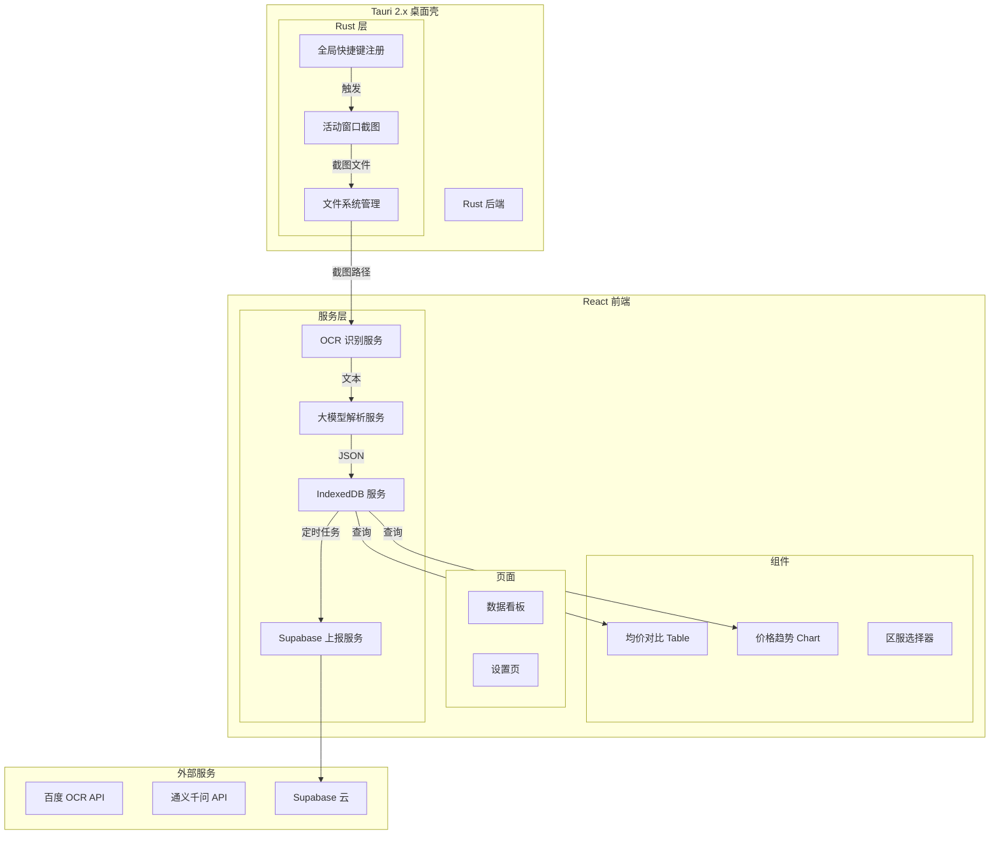

## 产品概述

梦幻西游电脑版快捷商品数据库客户端工具，基于 Tauri 2.x + React 构建桌面应用。用户通过全局快捷键一键截取游戏窗口，工具自动识别截图中的商品信息并结构化存储，支持多区服商品均价对比和价格趋势分析，每日自动将均价数据上报至 Supabase 云数据库。

## 核心功能

1. **全局快捷键截图**：注册全局快捷键（默认 Ctrl+Shift+S），即使工具窗口在后台也能截取当前活动窗口，截图自动保存至本地 `{游戏名}/{区服}/` 目录。
2. **OCR+大模型识别管线**：截图后先调用百度 OCR 提取文本，再调用通义千问/DeepSeek 大模型 API 将文本解析为结构化 JSON（商品名、卖家、价格、数量、区服、日期等）。
3. **IndexedDB 本地存储**：使用 Dexie.js 封装 IndexedDB，存储商品记录，支持按商品、区服、日期等维度查询。
4. **均价对比展示**：公共 Table 组件按商品名称展示各服均价，自动剔除价差过大的异常样本（IQR 法）；Recharts 折线图展示商品历史价格趋势。
5. **每日数据上报**：定时任务每天将本地采集的均价数据（商品名+区服+均价+样本数）上报到 Supabase。
6. **区服管理**：支持添加/切换/删除游戏区服，截图时选择当前区服，数据按区服归类。

## 技术栈

| 层级 | 技术 | 说明 |
| --- | --- | --- |
| 桌面框架 | Tauri 2.x | Rust 后端，全局快捷键+窗口截图 |
| 前端框架 | React 18 + TypeScript | UI 层 |
| 构建工具 | Vite 5 | 开发&打包 |
| 样式 | TailwindCSS 3 | 原子化 CSS |
| 代码规范 | ESLint + Prettier | 代码质量 |
| 本地数据库 | Dexie.js (IndexedDB) | 商品数据存储 |
| 云数据库 | Supabase | 均价数据上报 |
| OCR | 百度 OCR API | 文字提取（500次/天免费） |
| 大模型 | 通义千问 / DeepSeek | 文本结构化解析 |
| 图表 | Recharts | 价格趋势图 |
| UI 组件 | shadcn/ui | Table、Dialog 等 |

## 实现方案

### 整体架构

### 数据流

1. **截图采集流**：全局快捷键 → Tauri Rust 截取活动窗口 → 保存 PNG 到 `{app_data_dir}/{game}/{server}/` → 返回路径给前端
2. **识别流**：前端读取截图 → 调用百度 OCR API 获取文本 → 调用大模型 API 解析为 JSON → 存入 IndexedDB
3. **展示流**：前端从 IndexedDB 查询 → 按商品+区服分组计算均价（IQR 剔除异常值） → Table 组件渲染 / Recharts 渲染趋势
4. **上报流**：定时检查（每天一次）→ 汇总当日各商品各服均价 → 调用 Supabase REST API 写入

### 关键技术决策

1. **IndexedDB 完全够用**：单表存储，字段简单，百万级数据无压力；Dexie.js 提供 Promise 化 API，开发体验好。无需引入 SQLite。
2. **OCR+大模型混合方案**：百度 OCR 免费额度 500次/天，日常足够；大模型选 DeepSeek-V3（¥1/百万 token，极低成本）或通义千问 Qwen-Max，只需解析短文本，每次调用约 500 token。
3. **异常值剔除**：使用 IQR（四分位距）法，Q1 - 1.5×IQR ~ Q3 + 1.5×IQR 范围外的样本视为异常，不参与均价计算。
4. **Tauri 截图方案**：Rust 侧使用 `screenshots` crate 或 Windows API 截取活动窗口，支持多显示器。
5. **全局快捷键**：Tauri 2.x 的 `plugin-global-shortcut`，支持自定义快捷键组合。

### 性能优化

- IndexedDB 按 `商品名+区服+日期` 建立复合索引，加速均价查询
- 截图压缩为 JPEG quality 80 后再 OCR，减少 API 传输耗时
- 均价计算在前端做缓存（React Query），避免重复遍历全量数据
- 上报任务使用 `setInterval` + 日期变更检测，避免频繁请求

### 安全与错误处理

- 百度 OCR / 大模型 API Key 存储在前端 localStorage（可后续迁移到 Tauri 安全存储）
- 识别失败时保留截图+OCR 文本，支持手动修正
- 网络异常时重试 3 次，指数退避

## 设计风格

采用暗色玻璃态风格（Dark Glassmorphism），灵感源自游戏 UI。深色半透明背景配以蓝紫色渐变点缀，营造沉浸式游戏工具氛围。毛玻璃卡片承载数据，霓虹色强调关键数值。

## 页面规划

### 页面1：数据看板（主页面）

- **顶部导航栏**：Logo + 区服选择器（Dropdown） + 设置入口图标 + 最近截图状态指示
- **均价对比表格区块**：shadcn Table 组件，行=商品名称，列=各服均价+全服均价，支持排序；异常样本数用小字灰显
- **价格趋势图区块**：点击表格行切换图表，Recharts LineChart 展示选中商品在各服的30天价格走势，多线叠加
- **快捷操作栏**：底部浮动栏，显示当前快捷键提示 + "手动截图"按钮 + 最近识别状态

### 页面2：设置页

- **快捷键设置卡片**：当前快捷键显示 + 修改入口 + 重置按钮
- **API 配置卡片**：百度 OCR API Key、大模型 API Key、模型选择（通义千问/DeepSeek）
- **区服管理卡片**：区服列表（增删改）+ 默认区服选择
- **Supabase 配置卡片**：URL + Anon Key + 上报状态开关
- **数据管理卡片**：清除本地数据 + 导出 JSON + 截图目录路径显示

### 页面3：截图历史（可合入看板）

- 缩略图网格列表，点击查看详情（原图 + 识别结果 JSON + 原始 OCR 文本）
- 支持手动修正识别结果并重新入库

## 交互设计

- 全局快捷键截屏后，右下角弹出 Toast 通知（识别中/成功/失败）
- 表格行 hover 高亮，点击切换趋势图数据源
- 趋势图支持鼠标悬停查看具体数值
- 所有数据操作有 loading 骨架屏过渡

## Agent Extensions

### SubAgent

- **code-explorer**
- 用途：在项目搭建完成后，探索项目结构、检查依赖安装情况和配置文件正确性
- 预期结果：确认所有文件就位、依赖版本兼容、配置无冲突